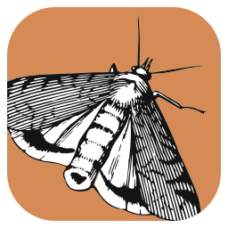
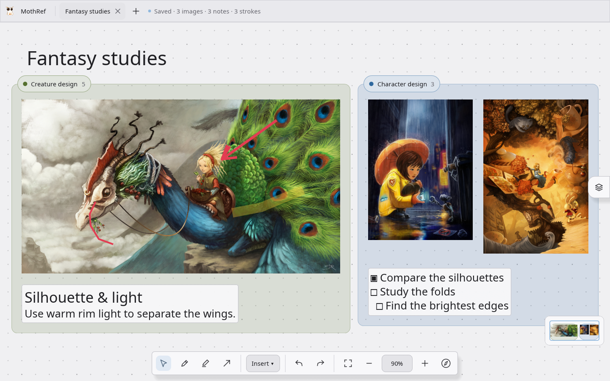
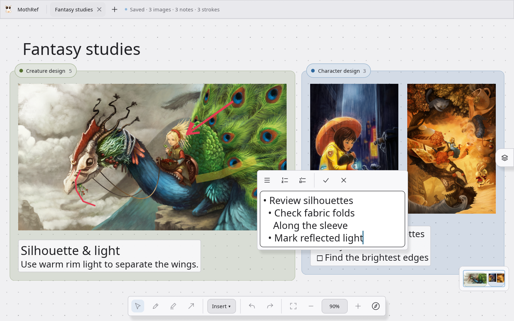
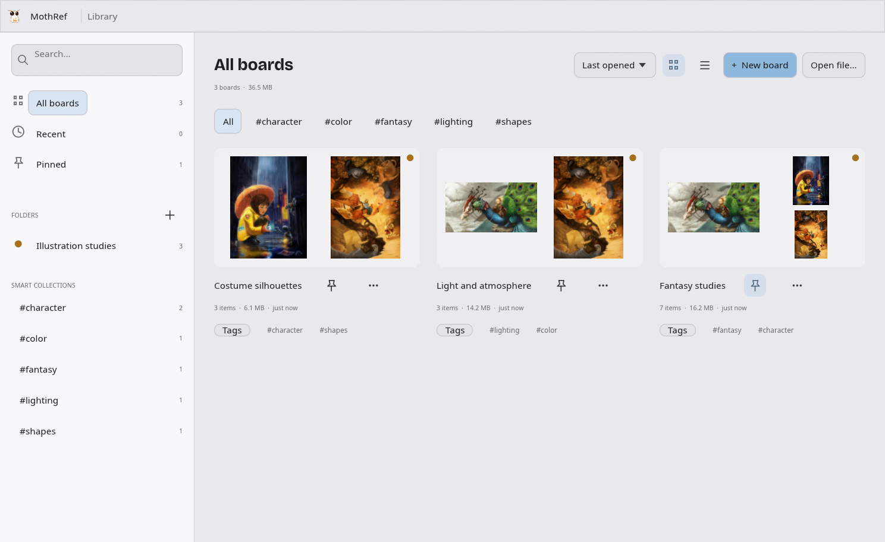
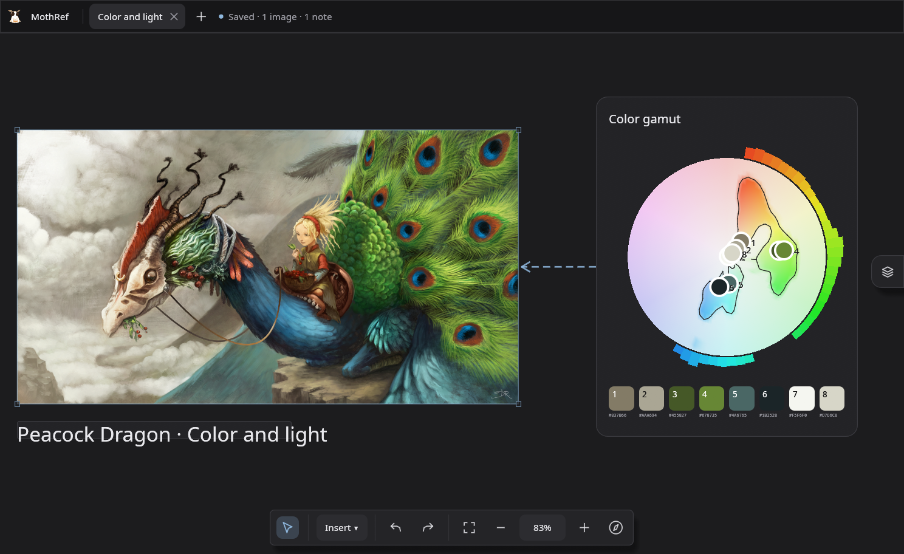

<div align="center">


&nbsp;&nbsp;&nbsp;


# MothRef

**A fast reference board for artists, with crash recovery.**<br>
Drop images onto an infinite canvas, arrange them, keep them in view while you work.

[](https://remade.wiki/projects/mothref/)
[](https://github.com/hlophlopgaming/mothRef/releases)
[](https://github.com/hlophlopgaming/mothRef/actions/workflows/ci.yml)
[](LICENSE)
[](https://www.rust-lang.org)


[**Download**](#download) · [Features](#features) · [Controls](#getting-around) · [Roadmap](#roadmap) · [CLI](#agent-cli) · [Build from source](#build-from-source) · [Docs](#documentation)

<sub><b>English</b> · <a href="README.ru.md">Русский</a> · <a href="README.es.md">Español</a> · <a href="README.pt-BR.md">Português (BR)</a> · <a href="README.fr.md">Français</a> · <a href="README.de.md">Deutsch</a> · <a href="README.it.md">Italiano</a> · <a href="README.pl.md">Polski</a> · <a href="README.sv.md">Svenska</a> · <a href="README.fi.md">Suomi</a> · <a href="README.el.md">Ελληνικά</a> · <a href="README.tr.md">Türkçe</a> · <a href="README.ar.md">العربية</a> · <a href="README.hi.md">हिन्दी</a> · <a href="README.zh-CN.md">简体中文</a> · <a href="README.ja.md">日本語</a> · <a href="README.ko.md">한국어</a></sub>

<br>



</div>

---

## Why MothRef

[BeeRef](https://github.com/rbreu/beeref) was a lovely open-source reference board, and it stopped moving.
[PureRef](https://www.pureref.com) is fast and polished, but closed. MothRef picks up where BeeRef left off:
native, open, and built to handle huge boards without eating your RAM.

| Priority | How it works |
| --- | --- |
| **Recover your work** | Board edits are journaled for crash recovery. Saves add checkpoints, and compaction replaces the file atomically. |
| **Keep large boards responsive** | Image caches have fixed budgets. By default, full-resolution images stay in video memory up to a hardware-based limit. |
| **Keep editing while images load** | Decoding, disk I/O and compression run in the background. |

The `.moth` format embeds and deduplicates original image bytes. If you enable downscaling on import,
the board stores a reduced copy and leaves the source file intact. See the [format specification](docs/FORMAT.md).

## Features

**Canvas and library**

- GPU rendering with `wgpu` (Vulkan, Metal or DirectX 12), with a software adapter option where supported
- Pan and zoom with a mouse, keyboard, trackpad or touch, navigate with the minimap, and edit the zoom percentage in the bottom toolbar
- Open boards in tabs. Search, sort, pin, tag and file boards in folders from the library
- After an unexpected shutdown, the next launch offers a crash report with recent log entries
- Use View mode for a compact reference window, or Over mode for an overlay with opacity and click-through controls. Pin above all windows or attach above a chosen window where supported
- Run timed drawing sessions full-screen or in a floating mini window, with fixed intervals or a custom plan

**Images, notes and layout**

- Paste, drop or open PNG, JPEG, AVIF, WebP, GIF and BMP images, including native file drops on Wayland
- Add plain text notes and organize items into nested groups in the Layers drawer
- Rotate, flip, crop, scale, adjust opacity or apply grayscale. Align, distribute or pack images of mixed sizes
- Use a line or dot grid, edge and center snapping, and alignment guides when moving items
- Open an image’s original file, archive or web address when its source is available. Arrange images by file path. Saved source paths travel with shared boards

**Import and export**

- Open BeeRef (`.bee`) and PureRef (`.pur`, 1.10 and 2.x) boards, including supported images, text notes and layout. MothRef reports unsupported content and saves edits to a separate `.moth` file
- Export a board, selection or region to PNG, SVG or PDF. Export original images individually, to a folder or as a ZIP
- Sample colors in HEX, RGB or HSV and add a color gamut card based on the visible part of an image

**Speed and customization**

- **Everything at full resolution** is the default. Images that fit are preloaded at full resolution, and the rest load on demand. Tiled zoom shows original detail beyond 2048 px
- Other performance modes let you keep detail levels in RAM, use lower zoom quality, cache to disk or disable caching. The RAM cache uses up to one eighth of available RAM (1 GiB maximum), and the disk cache uses up to 8 GiB
- Rebind keyboard and mouse controls, choose BeeRef- or PureRef-style navigation, and search actions with the command palette
- Choose a light or dark theme, reduced motion, an optional menu bar and an alternate moth icon. The interface is available in English and Russian. See [localization](docs/LOCALIZATION.md)

### In development on `main`

- Group images by their source folder from the context menu or command palette, or enable automatic grouping in Settings › Adding. Images need a recorded folder of origin
- Toggle **Snap to points** and set its spacing in the canvas context menu or the selection’s More menu. Hold <kbd>Shift</kbd> while dragging to bypass it
- View mode shows groups, titles, notes and the selection. The **Images only** option is in Over mode. Timed drawing sessions keep the resized mini window’s longer side when advancing or skipping
- Choose **Label**, **Note**, or **List** from **Insert**. Labels are plain text on the canvas. Notes and lists use cards with formatting controls. Checkboxes can be toggled directly on the board
- Draw with **Pen**, **Marker**, or **Arrow** in the bottom toolbar. Set their color and thickness in Settings › Canvas and navigation. Strokes can be moved, resized, and exported with the board
- Boards saved from `main` use schema 11 and require an updated MothRef to reopen. The public alpha saves schema 9. See the [changelog](CHANGELOG.md) for recovery fixes, the AVIF decoder upgrade and dependency updates

In the list editor, <kbd>Enter</kbd> adds an item and exits the list on an empty item.
Use <kbd>Shift</kbd>+<kbd>Enter</kbd> for a line break within an item and
<kbd>Tab</kbd> / <kbd>Shift</kbd>+<kbd>Tab</kbd> to change its level. Save the draft with
<kbd>Ctrl</kbd>+<kbd>Enter</kbd> (<kbd>Cmd</kbd>+<kbd>Enter</kbd> on macOS).

<details>
<summary><b>Editing a nested list</b> (screenshot)</summary>
<br>

</details>

<details>
<summary><b>Board library</b> (screenshot)</summary>
<br>

</details>

<details>
<summary><b>Color gamut</b> (screenshot)</summary>
<br>

</details>

## Download

Download the [public alpha from GitHub Releases](https://github.com/hlophlopgaming/mothRef/releases).
Version `0.3.0-alpha.2` offers a Windows ZIP and setup wizard, macOS archives and DMGs
(Apple Silicon and Intel), Linux x86_64 tarball, AppImage, DEB and RPM (Ubuntu 24.04
or a compatible distribution), a Linux ARM64 tarball and AppImage, and an Arch package
and build recipe, plus `SHA256SUMS`. See the [release notes for direct downloads](docs/releases/v0.3.0-alpha.2.md#downloads)
and [formats and installation](docs/RELEASING.md#downloads-and-installation). The
installers and packages are new in this release and have not been checked by hand on
every system yet.

Windows binaries are unsigned. macOS builds are not notarized.

## Getting around

| To do this | Use |
| --- | --- |
| Add images | Drop files, <kbd>Ctrl</kbd>+<kbd>V</kbd>, or **Insert → Paste** |
| Pan | Middle-drag, <kbd>Space</kbd>+drag or <kbd>W</kbd>/<kbd>A</kbd>/<kbd>S</kbd>/<kbd>D</kbd> |
| Zoom | Mouse wheel, pinch, or the <kbd>+</kbd> / <kbd>−</kbd> buttons |
| Fit everything | <kbd>Home</kbd>, or tap <kbd>Space</kbd> with nothing selected |
| Fit the selection | Tap <kbd>Space</kbd>, or double-click a selected image (again to go back) |
| Duplicate while dragging | <kbd>Alt</kbd>+drag |
| Rotate / flip | <kbd>R</kbd> / <kbd>Shift</kbd>+<kbd>H</kbd>, <kbd>Shift</kbd>+<kbd>V</kbd> |
| Group the selection | <kbd>Ctrl</kbd>+<kbd>G</kbd> |
| View / timed drawing session | <kbd>Tab</kbd> / <kbd>F5</kbd> |
| Command palette | <kbd>Ctrl</kbd>+<kbd>K</kbd> |
| Settings / shortcut cheat sheet | <kbd>Ctrl</kbd>+<kbd>O</kbd> / <kbd>/</kbd> |
| Arrange / edit / export selection | Selection bar, context menu or command palette |

On macOS, use <kbd>Cmd</kbd> instead of <kbd>Ctrl</kbd>. The full list, plus a side-by-side comparison with
PureRef, is in [docs/SHORTCUTS.md](docs/SHORTCUTS.md).

<details>
<summary><b>Known limitations</b></summary>

- Overlay and window controls depend on the desktop environment. See [native qualification](ROADMAP.md#qualification).
- Animated GIF playback and snapping while resizing are on the roadmap. Gamut cards are currently visible on the board only.
- PureRef links, rich notes, drawings and some crops are not imported yet.

</details>

## Roadmap

| Release | Scope | Status |
| --- | --- | --- |
| **0.3** public alpha | BeeRef parity, PureRef import, zoom and memory modes | First public alpha released |
| **0.7** beta | PureRef 2 parity, including drawing tools, rich notes and composition overlays | In development |
| **1.0** | Expanded board library, Milanote-style elements, broader import support and release qualification | Planned |
| After **1.0** | Web, collaboration, artist tools and capture integrations | Planned |
| No target release | Android | Planned |

See [milestones and performance targets](ROADMAP.md) and the [feature matrix](docs/FEATURES.md).

## Agent CLI

The same `mothref` executable contains ordinary headless subcommands and a
stateful `--agent` JSON Lines interface. No extra runtime is required.

```sh
mothref create references.moth
mothref add references.moth image.jpg
mothref arrange references.moth --mode grid --gap 24
mothref info references.moth --json
```

Use `mothref --help`, the [CLI reference](docs/CLI.md) and the
[agent guide](skills/cli-anything-mothref/SKILL.md) for commands and JSON scripts.
The catalog and agent guide are also embedded in `mothref commands --json`.
Builds from `main` support `note --kind label|note|list` and `stroke --style pen|marker|arrow`.
On `main`, use `group-origin` or `add --group-origin` for source-folder grouping
and `snap-grid` to snap items to a given grid spacing.

## Build from source

You need [Rust](https://rustup.rs) 1.98 or newer plus CMake, a C/C++ toolchain and NASM for x86/x86_64 builds. On Linux, also install the X11/Wayland headers
(`libxkbcommon-dev`, `libdbus-1-dev` and `libwayland-dev` on Debian/Ubuntu).

```sh
git clone https://github.com/hlophlopgaming/mothRef.git
cd mothRef
cargo run -p mothref --release
```

On Arch/EndeavourOS, install the native build dependencies with:

```sh
sudo pacman -S --needed base-devel rust cmake nasm libxkbcommon libxkbcommon-x11 libx11 libxcursor libxi libxrandr wayland dbus
```

Release packaging also produces an Arch build recipe and a pacman package; see
[packaging and installation](docs/RELEASING.md#downloads-and-installation).

Use `--release` for normal use. Optimized builds decode images faster.

```sh
cargo run -p mothref --release -- image.png reference.jpg   # open images at startup
cargo run -p mothref --release -- board.moth                # open a board
cargo run -p mothref --release -- --software                # request a software GPU adapter
```

<details>
<summary><b>Checks, benchmarks and fuzzing</b></summary>

```sh
cargo fmt --all --check
cargo clippy --workspace --all-targets -- -D warnings
cargo test --workspace
cargo deny check
cargo xtask corpus           # round-trip every file in corpus/
cargo xtask bench --quick    # render, io and scene benchmarks
cargo xtask paste            # paste-to-visible measurement
cargo xtask soak 1800        # long-running memory plateau check
```

`xtask` uses optimized builds so timings exclude debug overhead. Use `bench --quick --enforce` on reference
hardware to enforce the 8 ms p99 frame budget, and `bench --quick --software` to exercise a CPU adapter.

For decoder fuzzing, install `cargo-fuzz` and a nightly toolchain:

```sh
mkdir -p fuzz/corpus/image_reader
cp corpus/images/* fuzz/corpus/image_reader/
cargo +nightly fuzz run image_reader fuzz/corpus/image_reader -- -max_total_time=300
```

Fuzz targets also exist for `moth_reader`, `bee_reader` and `pur_reader`.

</details>

<details>
<summary><b>Project layout</b></summary>

```
crates/
  mothref/        the app: event loop, windows, tabs
  moth-scene/     scene graph, commands, undo/redo        (no GPU, no I/O)
  moth-format/    .moth reader/writer, journal, recovery
  moth-io/        image decoding, preview and tile caches
  moth-render/    wgpu renderer
  moth-ui/        egui interface, theme, motion, localization
  moth-platform/  OS-specific code: clipboard, input, settings
  moth-import/    BeeRef .bee and PureRef .pur import
  moth-thumb/     thumbnails for file managers
third_party/purcore/  attributed fork of LazyRef's .pur reader
xtask/          benchmarks, corpus checks, soak tests
corpus/         test boards and images
docs/           format spec, architecture, decisions
```

</details>

## Documentation

- [Architecture](docs/ARCHITECTURE.md) and [design decisions](docs/decisions/)
- [The `.moth` file format](docs/FORMAT.md)
- [Controls and PureRef shortcut comparison](docs/SHORTCUTS.md)
- [CLI and JSON automation](docs/CLI.md)
- [PureRef import notes](docs/PUR-IMPORT.md)
- [Load performance](docs/LOAD-PERFORMANCE.md)
- [Adding a language](docs/LOCALIZATION.md)
- [Release process](docs/RELEASING.md) and [changelog](CHANGELOG.md)

## Contributing

Bug reports and ideas are welcome in [Issues](https://github.com/hlophlopgaming/mothRef/issues).
Before sending code, read [AGENTS.md](AGENTS.md): it covers the architecture rules, data-safety rules and which
checks to run. It applies to humans and AI coding agents alike.

## License and credits

MothRef is free software under the **[GNU GPL v3.0 or later](LICENSE)**.
Third-party fonts and code are listed in [THIRD_PARTY.md](THIRD_PARTY.md).

PureRef import is built on a fork of [`purcore`](https://github.com/achrllrogia45/LazyRef) from LazyRef (MIT).
"BeeRef", "PureRef" and "Milanote" are named only to describe compatibility; MothRef is not affiliated with them.

Artwork in the screenshots is by [David Revoy](https://www.davidrevoy.com):
[Electron donor](https://www.peppercarrot.com/en/viewer/misc__2010-08-19-electron-donor_by-David-Revoy.html),
[Peacock dragon](https://commons.wikimedia.org/wiki/File:2013-04-28_peacock-dragon_by-David-Revoy.jpg)
and [Alice in Wonderland](https://www.davidrevoy.com/article36/alice-in-wonderland),
licensed under [CC BY 4.0](https://creativecommons.org/licenses/by/4.0/). The illustrations are scaled for display.

<div align="center">
<br>
<sub>Made with Rust and a lot of moths.</sub>
</div>
