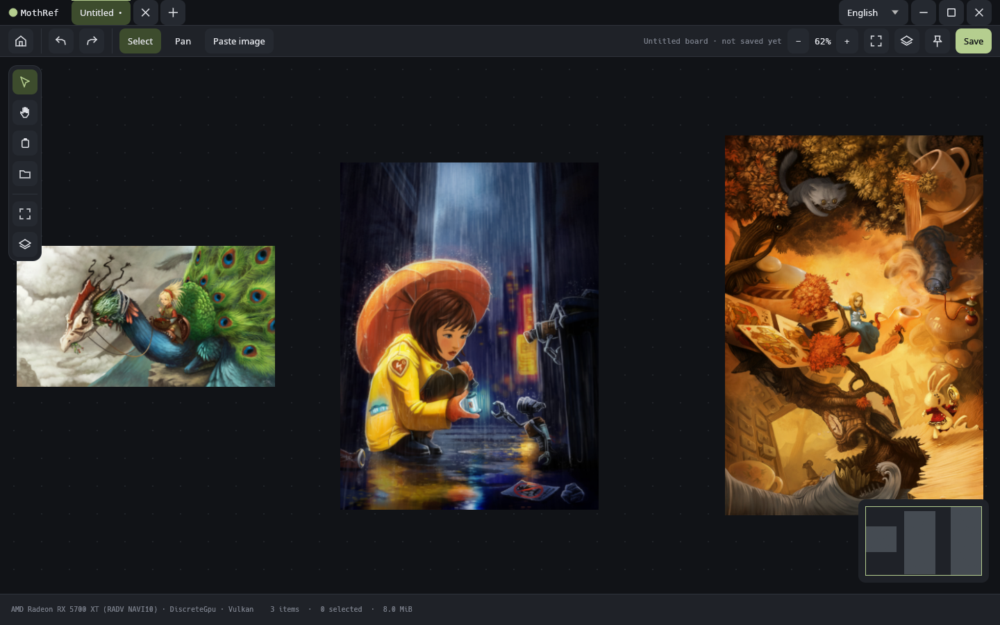
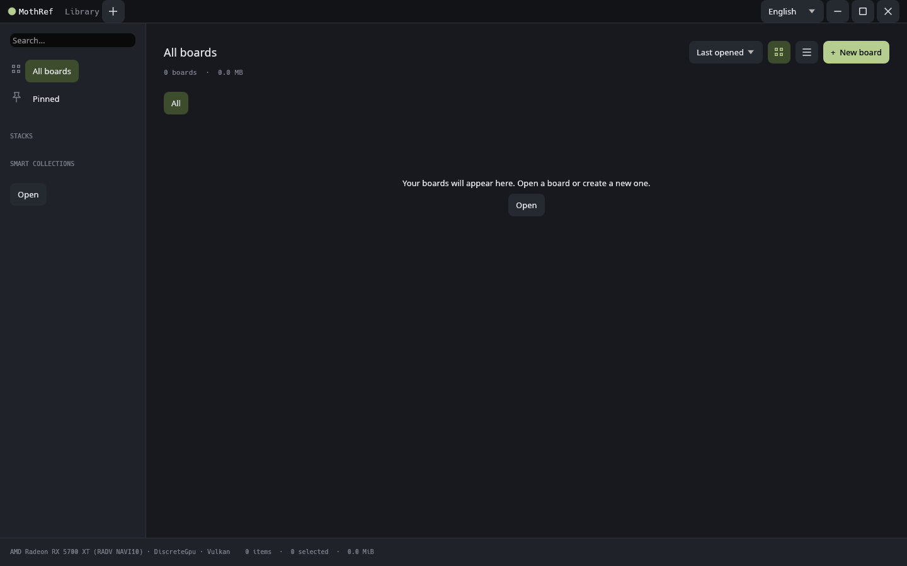

<div align="center">

<picture>
  <source media="(prefers-color-scheme: dark)" srcset="docs/assets/mothref-logo-dark.png">
  
</picture>

# MothRef

**A fast, crash-proof reference board for artists.**<br>
Drop images onto an infinite canvas, arrange them, keep them in view while you work.

[](https://remade.wiki/projects/mothref/)
[](https://github.com/hlophlopgaming/mothRef/releases)
[](https://github.com/hlophlopgaming/mothRef/actions/workflows/ci.yml)
[](LICENSE)
[](https://www.rust-lang.org)


[**Download**](#download) · [Features](#features) · [Controls](#getting-around) · [Roadmap](#roadmap) · [Build from source](#build-from-source) · [Docs](#documentation)

<sub><b>English</b> · <a href="README.ru.md">Русский</a> · <a href="README.es.md">Español</a> · <a href="README.pt-BR.md">Português (BR)</a> · <a href="README.fr.md">Français</a> · <a href="README.de.md">Deutsch</a> · <a href="README.it.md">Italiano</a> · <a href="README.pl.md">Polski</a> · <a href="README.sv.md">Svenska</a> · <a href="README.fi.md">Suomi</a> · <a href="README.el.md">Ελληνικά</a> · <a href="README.tr.md">Türkçe</a> · <a href="README.ar.md">العربية</a> · <a href="README.hi.md">हिन्दी</a> · <a href="README.zh-CN.md">简体中文</a> · <a href="README.ja.md">日本語</a> · <a href="README.ko.md">한국어</a></sub>

<br>



</div>

> [!WARNING]
> MothRef is in **early alpha** (`0.1.0-alpha`). Saving, recovery and undo work, but long reliability
> qualification is still pending. Keep separate copies of important boards and original images.

---

## Why MothRef

[BeeRef](https://github.com/rbreu/beeref) was a lovely open-source reference board, and it stopped moving.
[PureRef](https://www.pureref.com) is fast and polished, but closed. MothRef picks up where BeeRef left off:
native, open, and built to handle huge boards without eating your RAM.

It is built around three promises, in this order:

| Promise | What it means in practice |
| --- | --- |
| **Never lose your work** | Every change goes to a recovery journal before it counts as done. A crash costs at most the last second. Board files are never overwritten in place. |
| **Memory follows a budget, not the board size** | Every cache has a limit and evicts the least recently used images. You choose the trade-off between zoom speed and memory. |
| **The interface never waits** | Decoding, disk and compression run off the main thread. An idle board uses 0% CPU and GPU. |

Board files use the `.moth` extension. The format is [documented](docs/FORMAT.md), stores your original image
bytes untouched (no re-encoding) and deduplicates identical images.

## Features

What works in the current alpha:

**Canvas**
- GPU canvas on `wgpu` (Vulkan, Metal, DirectX 12) with a software fallback (`--software`)
- Smooth zoom around the pointer, inertial touch pan, pinch zoom and trackpad gestures
- Board tabs and a board library start screen
- Minimap, editable zoom level, live selection size and memory use in the status bar
- Animations with a reduced-motion setting

**Images and notes**
- Paste (<kbd>Ctrl</kbd>+<kbd>V</kbd>), drop or open PNG, JPEG, WebP, GIF and BMP files
- Plain text notes: double-click empty canvas to create one, double-click a note to edit it
- Rotate, flip, crop, scale, opacity and grayscale, all undoable

**Arranging**
- Move, Alt-drag to duplicate, arrow-key nudges
- Align, distribute, stack, layer order and optimal packing of mixed-size images
- Fit the whole board or the current selection with a tap of <kbd>Space</kbd>

**Compatibility**
- Opens **BeeRef** `.bee` boards: images, text notes, rotation, flip and scale
- Opens **PureRef** `.pur` boards (1.10 and 2.x): embedded images and plain notes; unsupported items are reported, never silently dropped

**Export**
- Boards, selections or cropped regions to PNG, SVG and PDF
- Original images exactly as they were added, singly or as a ZIP
- Color picker that copies HEX, RGB or HSV

**Speed and memory**
- PureRef-style performance modes: *In memory* (default), *In memory, low zoom quality*, *Cache on disk*, *No cache*
- Each image is decoded once per zoom range; later zoom steps reuse cached detail levels
- RAM cache capped at 25% of available memory (max 4 GiB), disk cache at 2 GiB

**Make it yours**
- Every keyboard and mouse binding is editable, with conflict previews
- BeeRef-style and PureRef-style navigation presets
- Command palette (<kbd>Ctrl</kbd>+<kbd>K</kbd>)
- Interface in English and Russian ([add your language](docs/LOCALIZATION.md))

<details>
<summary><b>Board library</b> (screenshot)</summary>
<br>

</details>

## Download

Grab the latest build from **[GitHub Releases](https://github.com/hlophlopgaming/mothRef/releases)**.

| Platform | File | How to run |
| --- | --- | --- |
| Windows x86_64 | `mothref-windows-x86_64.zip` | Extract and run `mothref.exe` |
| macOS, Apple Silicon | `mothref-macos-arm64.tar.gz` | Extract and run `mothref` from Terminal |
| macOS, Intel | `mothref-macos-x86_64.tar.gz` | Extract and run `mothref` from Terminal |
| Linux x86_64 | `mothref-linux-x86_64.tar.gz` | Extract and run `./mothref` (Ubuntu 24.04 or newer, or compatible) |

Binaries are unsigned, and macOS builds are not notarized yet, so your OS may ask you to confirm the first launch.
SHA-256 checksums are published with every release.

Installers and package managers (MSI, `.dmg`, AppImage, Flatpak, Homebrew, AUR and more) are
[planned](ROADMAP.md#distribution) from 0.3 onward.
An **Android** app and a **web** version are planned too; the core is already written to stay portable to both.

## Getting around

| To do this | Use |
| --- | --- |
| Add images | Drop files, <kbd>Ctrl</kbd>+<kbd>V</kbd>, or **Insert → Paste** |
| Pan | Middle-drag or <kbd>Space</kbd>+drag |
| Zoom | Mouse wheel, pinch, or the <kbd>+</kbd> / <kbd>−</kbd> buttons |
| Fit everything | <kbd>Home</kbd>, or tap <kbd>Space</kbd> with nothing selected |
| Fit the selection | Tap <kbd>Space</kbd>, or double-click a selected image (again to go back) |
| Duplicate while dragging | <kbd>Alt</kbd>+drag |
| Rotate / flip | <kbd>R</kbd> / <kbd>Shift</kbd>+<kbd>H</kbd>, <kbd>Shift</kbd>+<kbd>V</kbd> |
| Command palette | <kbd>Ctrl</kbd>+<kbd>K</kbd> |
| Settings / edit bindings | <kbd>Ctrl</kbd>+<kbd>,</kbd>; **Keys and mouse** |
| Arrange / edit / export selection | Selection bar, context menu or command palette |

On macOS, use <kbd>Cmd</kbd> instead of <kbd>Ctrl</kbd>. The full list, plus a side-by-side comparison with
PureRef, is in [docs/SHORTCUTS.md](docs/SHORTCUTS.md).

<details>
<summary><b>Known limitations</b></summary>

- Native Wayland file drops are not available yet (a winit 0.30 limitation). Use X11/XWayland, pass images on the command line, or paste.
- Boards support up to 10,000 items; previews show up to 2048 px of detail per image. Full-resolution tiled zoom is on the roadmap.
- PureRef links, rich notes, drawings and some crops are not imported yet.

</details>

## Roadmap

| Release | Milestone | Promise | Status |
| --- | --- | --- | --- |
| **0.1** pre-alpha | M1 | Does not lose data | alpha builds out |
| **0.3** public alpha | M2, M2.5 | Replaces BeeRef, opens `.bee` and `.pur`, zooms faster than PureRef | in progress |
| **0.7** beta | M3, M4 | Overlay mode, browser extension, PureRef 2 feature parity | planned |
| **1.0** | M5–M7 | Board library with stacks and tags, Milanote-style elements, all performance targets met | planned |
| **2.0** | M8, M9 | Web build and real-time collaboration | later |
| — | — | Android app | planned |

After 1.0: artist tools, review and presentation mode, Obsidian/Markdown interop and a command-line tool.
The full plan, feature checklists and performance targets live in [ROADMAP.md](ROADMAP.md).

## Build from source

You need [Rust](https://rustup.rs) 1.95 or newer. On Linux, also install the X11/Wayland headers
(`libxkbcommon-dev`, `libdbus-1-dev` and `libwayland-dev` on Debian/Ubuntu).

```sh
git clone https://github.com/hlophlopgaming/mothRef.git
cd mothRef
cargo run -p mothref --release
```

Always use `--release`: image decoders depend on optimizations, and debug builds are much slower.

```sh
cargo run -p mothref --release -- image.png reference.jpg   # open images at startup
cargo run -p mothref --release -- board.moth                # open a board
cargo run -p mothref --release -- --software                # force the CPU renderer
```

<details>
<summary><b>Checks, benchmarks and fuzzing</b></summary>

```sh
cargo fmt --all --check
cargo clippy --workspace --all-targets -- -D warnings
cargo test --workspace
cargo deny check
cargo xtask corpus           # round-trip every file in corpus/
cargo xtask bench --quick    # render, io and scene benchmarks
cargo xtask paste            # paste-to-visible measurement
cargo xtask soak 1800        # long-running memory plateau check
```

`xtask` uses optimized builds so timings exclude debug overhead. Use `bench --quick --enforce` on reference
hardware to enforce the 8 ms p99 frame budget, and `bench --quick --software` to exercise a CPU adapter.

For decoder fuzzing, install `cargo-fuzz` and a nightly toolchain:

```sh
mkdir -p fuzz/corpus/image_reader
cp corpus/images/* fuzz/corpus/image_reader/
cargo +nightly fuzz run image_reader fuzz/corpus/image_reader -- -max_total_time=300
```

Fuzz targets also exist for `moth_reader`, `bee_reader` and `pur_reader`.

</details>

<details>
<summary><b>Project layout</b></summary>

```
crates/
  mothref/        the app: event loop, windows, tabs
  moth-scene/     scene graph, commands, undo/redo        (no GPU, no I/O)
  moth-format/    .moth reader/writer, journal, recovery
  moth-io/        image decoding, detail levels, caches
  moth-render/    wgpu renderer
  moth-ui/        egui interface, theme, motion, localization
  moth-platform/  OS-specific code: clipboard, input, settings
  moth-import/    BeeRef .bee and PureRef .pur import
third_party/purcore/  attributed fork of LazyRef's .pur reader
xtask/          benchmarks, corpus checks, soak tests
corpus/         test boards and images
docs/           format spec, architecture, decisions
```

</details>

## Documentation

- [Architecture](docs/ARCHITECTURE.md) and [design decisions](docs/decisions/)
- [The `.moth` file format](docs/FORMAT.md)
- [Controls and PureRef shortcut comparison](docs/SHORTCUTS.md)
- [PureRef import notes](docs/PUR-IMPORT.md)
- [Load performance](docs/LOAD-PERFORMANCE.md)
- [Adding a language](docs/LOCALIZATION.md)
- [Release process](docs/RELEASING.md) and [changelog](CHANGELOG.md)

## Contributing

Bug reports and ideas are welcome in [Issues](https://github.com/hlophlopgaming/mothRef/issues).
Before sending code, read [AGENTS.md](AGENTS.md): it covers the architecture rules, data-safety rules and which
checks to run. It applies to humans and AI coding agents alike.

## License and credits

MothRef is free software under the **[GNU GPL v3.0 or later](LICENSE)**.
Third-party fonts and code are listed in [THIRD_PARTY.md](THIRD_PARTY.md).

PureRef import is built on a fork of [`purcore`](https://github.com/achrllrogia45/LazyRef) from LazyRef (MIT).
"BeeRef", "PureRef" and "Milanote" are named only to describe compatibility; MothRef is not affiliated with them.

Artwork in the screenshot is by [David Revoy](https://www.davidrevoy.com):
[Electron donor](https://www.peppercarrot.com/en/viewer/misc__2010-08-19-electron-donor_by-David-Revoy.html),
[Peacock dragon](https://commons.wikimedia.org/wiki/File:2013-04-28_peacock-dragon_by-David-Revoy.jpg)
and [Alice in Wonderland](https://www.davidrevoy.com/article36/alice-in-wonderland),
licensed under [CC BY 4.0](https://creativecommons.org/licenses/by/4.0/). The illustrations are scaled for display.

<div align="center">
<br>
<sub>Made with Rust and a lot of moths.</sub>
</div>
