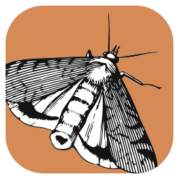
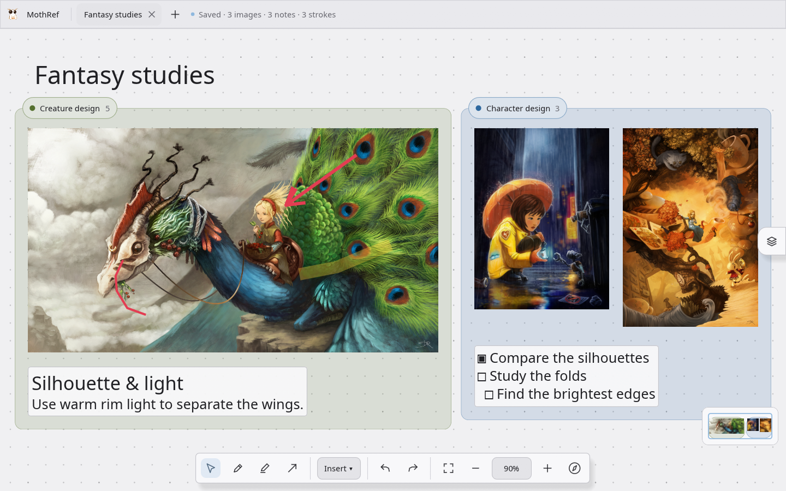
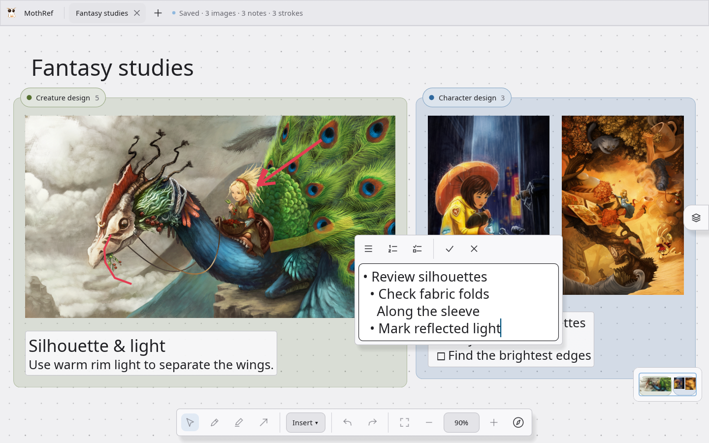
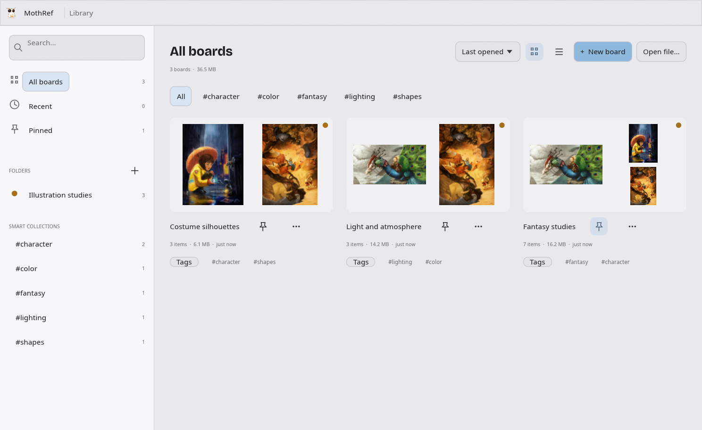
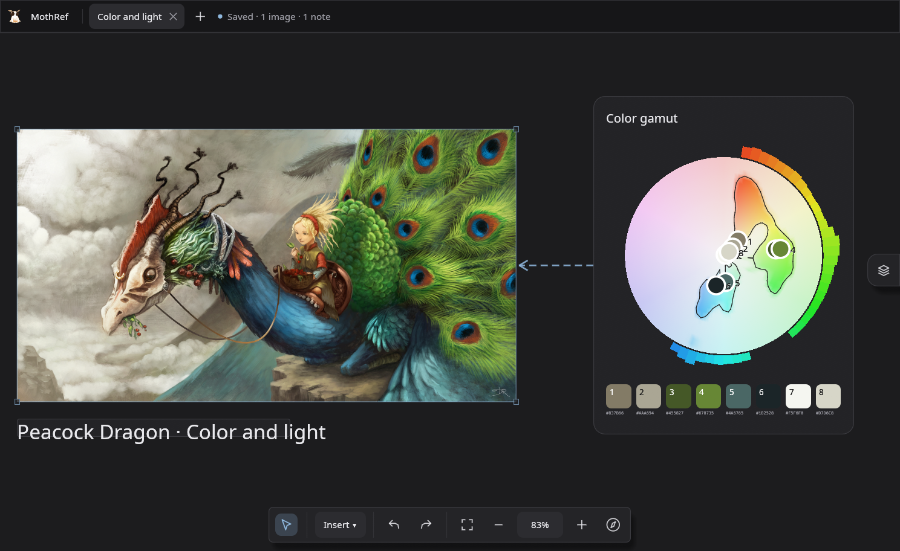

<div align="center">


&nbsp;&nbsp;&nbsp;


# MothRef

**Быстрая доска референсов для художников с восстановлением после сбоя.**<br>
Бросайте картинки на бесконечный холст, раскладывайте их и держите перед глазами, пока работаете.

[](https://remade.wiki/projects/mothref/)
[](https://github.com/hlophlopgaming/mothRef/releases)
[](https://github.com/hlophlopgaming/mothRef/actions/workflows/ci.yml)
[](LICENSE)
[](https://www.rust-lang.org)


[**Скачать**](#download) · [Возможности](#features) · [Управление](#getting-around) · [Планы](#roadmap) · [CLI](#agent-cli) · [Сборка](#build-from-source) · [Документация](#documentation)

<sub><a href="README.md">English</a> · <b>Русский</b> · <a href="README.es.md">Español</a> · <a href="README.pt-BR.md">Português (BR)</a> · <a href="README.fr.md">Français</a> · <a href="README.de.md">Deutsch</a> · <a href="README.it.md">Italiano</a> · <a href="README.pl.md">Polski</a> · <a href="README.sv.md">Svenska</a> · <a href="README.fi.md">Suomi</a> · <a href="README.el.md">Ελληνικά</a> · <a href="README.tr.md">Türkçe</a> · <a href="README.ar.md">العربية</a> · <a href="README.hi.md">हिन्दी</a> · <a href="README.zh-CN.md">简体中文</a> · <a href="README.ja.md">日本語</a> · <a href="README.ko.md">한국어</a></sub>

<br>



</div>

---

<a id="why-mothref"></a>

## Зачем MothRef

[BeeRef](https://github.com/rbreu/beeref) был отличной открытой доской референсов, но его развитие остановилось. [PureRef](https://www.pureref.com) быстрый и отполированный, но закрытый. MothRef продолжает дело BeeRef: нативный, открытый и рассчитанный на огромные доски без пожирания оперативной памяти.

| Приоритет | Как это работает |
| --- | --- |
| **Восстановление работы** | Изменения доски записываются в журнал восстановления. Сохранение добавляет контрольную точку, а при уплотнении файл заменяется атомарно. |
| **Отзывчивость на больших досках** | У кэшей есть лимиты. По умолчанию изображения остаются в видеопамяти в полном разрешении, пока хватает лимита, определённого для вашей видеокарты. |
| **Работа во время загрузки** | Декодирование, операции с диском и сжатие выполняются в фоне. |

Формат `.moth` хранит исходные байты изображений внутри доски и
объединяет одинаковые файлы. Если включить уменьшение при импорте, в доску
запишется уменьшенная копия, а исходный файл останется цел. См. [спецификацию формата](docs/FORMAT.md).

<a id="features"></a>

## Возможности

**Холст и библиотека**

- Рендеринг на GPU через `wgpu` (Vulkan, Metal или DirectX 12). Там, где это поддерживается, можно выбрать программный адаптер
- Перемещение и масштабирование мышью, клавиатурой, тачпадом или касаниями. Миникарта и поле масштаба в нижней панели
- Вкладки досок. В библиотеке можно искать, сортировать, закреплять доски и раскладывать их по папкам и тегам
- После сбоя при следующем запуске можно открыть отчёт с последними записями журнала
- Компактный режим просмотра и режим поверх других окон с настройками прозрачности и пропуска кликов. Можно закрепить MothRef поверх всех окон или привязать к выбранному окну на поддерживаемых системах
- Сеансы рисования по таймеру во весь экран или в плавающем мини-окне, с фиксированным интервалом или по своему плану

**Изображения, заметки и раскладка**

- Вставка, перетаскивание и открытие PNG, JPEG, AVIF, WebP, GIF и BMP. Перетаскивание файлов работает и в нативном Wayland
- Простые текстовые заметки и вложенные группы с деревом в панели слоёв
- Поворот, отражение, кадрирование, масштаб, прозрачность и оттенки серого. Выравнивание, распределение и плотная упаковка изображений разного размера
- Сетка из линий или точек, привязка краёв и центров и направляющие при перемещении
- Переход к исходному файлу, архиву или веб-адресу, если источник известен. Раскладка по пути к файлу. Сохранённые пути видны и тем, кому вы отправляете доску

**Импорт и экспорт**

- Открытие досок BeeRef (`.bee`) и PureRef (`.pur`, 1.10 и 2.x) с поддерживаемыми изображениями, заметками и раскладкой. MothRef сообщает о неподдерживаемых элементах и сохраняет изменения в отдельный файл `.moth`
- Экспорт доски, выделения или области в PNG, SVG и PDF, экспорт оригиналов по одному, в папку или в ZIP
- Пипетка с копированием в HEX, RGB или HSV и карточки цветового охвата по видимой области изображения

**Скорость и настройки**

- По умолчанию включено **«Всё в полном разрешении»**. Изображения предварительно загружаются в видеопамять до её лимита, остальные подгружаются по мере необходимости. Тайловый зум позволяет видеть исходные детали крупнее 2048 пикселей
- Другие режимы позволяют хранить уровни детализации в ОЗУ, снизить качество зума, использовать дисковый кэш или отключить кэширование. Кэш в ОЗУ занимает до одной восьмой доступной памяти (не более 1 ГиБ), дисковый — до 8 ГиБ
- Настраиваемые сочетания клавиш и кнопок мыши, пресеты BeeRef и PureRef и поиск действий в палитре команд
- Светлая и тёмная темы, уменьшение анимаций, отдельная строка меню и альтернативная иконка. Интерфейс доступен на русском и английском. См. [локализацию](docs/LOCALIZATION.md)

### В разработке в `main`

- Изображения с известной исходной папкой можно собрать в группы через контекстное меню или палитру команд. Автоматическая группировка включается в настройках добавления изображений
- **Привязка к точкам** и её шаг настраиваются в контекстном меню холста или в меню дополнительных действий выделения. Удерживайте <kbd>Shift</kbd> при перетаскивании, чтобы временно отключить привязку
- В режиме просмотра видны группы, заголовки, заметки и выделение. Фильтр **«Только изображения»** перенесён в режим поверх окон. В сеансе рисования длинная сторона мини-окна сохраняет размер при смене изображения
- В меню **«Вставить»** есть **«Надпись»**, **«Заметка»** и **«Список»**. Надпись — это текст прямо на холсте. У заметок и списков есть карточка и панель форматирования. Галочки переключаются прямо на доске
- **Перо**, **Маркер** и **Стрелка** доступны в нижней панели. Цвет и толщина задаются в разделе настроек холста. Штрихи можно перемещать, масштабировать и экспортировать вместе с доской
- Доски из `main` сохраняются в схеме 11 и для повторного открытия требуют обновлённый MothRef. Публичная альфа сохраняет в схеме 9. Исправления восстановления, обновление декодера AVIF и зависимостей описаны в [журнале изменений](CHANGELOG.md)

В редакторе списка <kbd>Enter</kbd> добавляет пункт, а на пустом пункте завершает список.
<kbd>Shift</kbd>+<kbd>Enter</kbd> переносит строку внутри пункта.
<kbd>Tab</kbd> и <kbd>Shift</kbd>+<kbd>Tab</kbd> меняют уровень вложенности.
<kbd>Ctrl</kbd>+<kbd>Enter</kbd> сохраняет черновик (<kbd>Cmd</kbd>+<kbd>Enter</kbd> на macOS).

<details>
<summary><b>Редактор вложенного списка (скриншот)</b></summary>
<br>

</details>

<details>
<summary><b>Библиотека досок (скриншот)</b></summary>
<br>

</details>

<details>
<summary><b>Цветовой охват (скриншот)</b></summary>
<br>

</details>

<a id="download"></a>

## Скачать

Скачайте [публичную альфу на GitHub Releases](https://github.com/hlophlopgaming/mothRef/releases).
Для `0.3.0-alpha.1` доступны архивы для Windows x86_64, macOS (Apple Silicon и Intel)
и Linux x86_64 (Ubuntu 24.04 или совместимый дистрибутив), а также файл контрольных
сумм `SHA256SUMS`. Прямые ссылки есть в [заметках к релизу](docs/releases/v0.3.0-alpha.1.md#downloads).

Пайплайн в `main` добавляет установщик Windows, DMG для macOS, AppImage, DEB и
RPM для Linux x86_64, AppImage и архив для Linux ARM64, а также пакет и рецепт
сборки для Arch. Эти форматы предназначены для будущих релизов. Проверки установки
и запуска на целевых системах ещё предстоят. См. [форматы и установку](docs/RELEASING.md#downloads-and-installation).

Сборки Windows не подписаны. Сборки macOS не прошли нотаризацию.

<a id="getting-around"></a>

## Управление

| Действие | Как |
| --- | --- |
| Добавить картинки | Перетащите файлы, нажмите <kbd>Ctrl</kbd>+<kbd>V</kbd> или выберите **Вставить** в нижней панели |
| Перемещать холст | Средняя кнопка мыши, <kbd>Space</kbd>+перетаскивание или <kbd>W</kbd>/<kbd>A</kbd>/<kbd>S</kbd>/<kbd>D</kbd> |
| Масштаб | Колесо мыши, щипок или кнопки <kbd>+</kbd> / <kbd>−</kbd> |
| Показать всё | <kbd>Home</kbd> или нажатие <kbd>Space</kbd> без выделения |
| Показать выделение | Нажатие <kbd>Space</kbd> или двойной щелчок по выделенной картинке (повторный — вернуться) |
| Копировать при перетаскивании | <kbd>Alt</kbd>+перетаскивание |
| Повернуть / отразить | <kbd>R</kbd> / <kbd>Shift</kbd>+<kbd>H</kbd>, <kbd>Shift</kbd>+<kbd>V</kbd> |
| Сгруппировать выделение | <kbd>Ctrl</kbd>+<kbd>G</kbd> |
| Просмотр / сеанс рисования | <kbd>Tab</kbd> / <kbd>F5</kbd> |
| Палитра команд | <kbd>Ctrl</kbd>+<kbd>K</kbd> |
| Настройки / список сочетаний | <kbd>Ctrl</kbd>+<kbd>O</kbd> / <kbd>/</kbd> |
| Разложить, изменить или экспортировать выделение | Панель выделения, контекстное меню или палитра команд |

На macOS вместо <kbd>Ctrl</kbd> используйте <kbd>Cmd</kbd>. Полный список и сравнение с PureRef — в [docs/SHORTCUTS.md](docs/SHORTCUTS.md) (на английском).

<details>
<summary><b>Известные ограничения</b></summary>

- Управление окнами и режимом поверх других приложений зависит от окружения рабочего стола. См. [проверки на целевых системах](ROADMAP.md#qualification).
- Воспроизведение GIF-анимации и привязка при изменении размера пока в планах. Карточки цветового охвата видны только на холсте.
- Ссылки, форматированные заметки, рисунки и часть кадрирований из PureRef пока не импортируются.

</details>

<a id="roadmap"></a>

## Планы

| Релиз | Что входит | Статус |
| --- | --- | --- |
| **0.3** публичная альфа | Возможности BeeRef, импорт PureRef, зум и режимы памяти | Первая публичная альфа вышла |
| **0.7** бета | Возможности PureRef 2, в том числе рисование, форматирование заметок и композиционные сетки | В разработке |
| **1.0** | Расширенная библиотека, элементы в стиле Milanote, расширенный импорт и проверки перед релизом | В планах |
| После **1.0** | Веб-версия, совместная работа, инструменты для художников и интеграции для захвата референсов | В планах |
| Версия пока не определена | Android | В планах |

См. [этапы и цели по производительности](ROADMAP.md) и [таблицу возможностей](docs/FEATURES.md).

<a id="agent-cli"></a>

## Командная строка и автоматизация

В сам `mothref` встроены команды для работы с досками без GUI и режим `--agent`
с протоколом JSON Lines. Дополнительная среда выполнения не нужна.

```sh
mothref create references.moth
mothref add references.moth image.jpg
mothref arrange references.moth --mode grid --gap 24
mothref info references.moth --json
```

Список команд и примеры есть в `mothref --help`, [справочнике CLI](docs/CLI.md)
и [руководстве для агентов](skills/cli-anything-mothref/SKILL.md). Каталог и
руководство также доступны через `mothref commands --json`. В сборке из `main`
тип текста выбирается через `note --kind label|note|list`, а инструмент для штриха
через `stroke --style pen|marker|arrow`. Команды
`group-origin` и `add --group-origin` группируют изображения по исходным папкам,
а `snap-grid` привязывает элементы к сетке с заданным шагом.

<a id="build-from-source"></a>

## Сборка из исходников

Нужны [Rust](https://rustup.rs) версии 1.98 или новее, CMake, компилятор C/C++ и NASM для сборок x86/x86_64. В Linux также установите заголовки X11/Wayland (`libxkbcommon-dev`, `libdbus-1-dev` и `libwayland-dev` в Debian/Ubuntu).

```sh
git clone https://github.com/hlophlopgaming/mothRef.git
cd mothRef
cargo run -p mothref --release
```

В Arch/EndeavourOS зависимости сборки устанавливаются одной командой:

```sh
sudo pacman -S --needed base-devel rust cmake nasm libxkbcommon libxkbcommon-x11 libx11 libxcursor libxi libxrandr wayland dbus
```

Релизный пайплайн также формирует рецепт сборки Arch и пакет для pacman;
см. [форматы и установку](docs/RELEASING.md#downloads-and-installation).

Для обычной работы используйте `--release`. Оптимизированная сборка быстрее декодирует изображения.

```sh
cargo run -p mothref --release -- image.png reference.jpg   # открыть картинки при запуске
cargo run -p mothref --release -- board.moth                # открыть доску
cargo run -p mothref --release -- --software                # запросить программный графический адаптер
```

<details>
<summary><b>Проверки, бенчмарки и фаззинг</b></summary>

```sh
cargo fmt --all --check
cargo clippy --workspace --all-targets -- -D warnings
cargo test --workspace
cargo deny check
cargo xtask corpus
cargo xtask bench --quick
cargo xtask paste
cargo xtask soak 1800
```

`xtask` собирает оптимизированные сборки, чтобы замеры не включали накладные расходы отладки. `bench --quick --enforce` на эталонном железе проверяет бюджет кадра 8 мс (p99), а `bench --quick --software` проверяет программный адаптер.

Для фаззинга декодеров установите `cargo-fuzz` и nightly-тулчейн:

```sh
mkdir -p fuzz/corpus/image_reader
cp corpus/images/* fuzz/corpus/image_reader/
cargo +nightly fuzz run image_reader fuzz/corpus/image_reader -- -max_total_time=300
```

Есть также цели фаззинга `moth_reader`, `bee_reader` и `pur_reader`.

</details>

<details>
<summary><b>Структура проекта</b></summary>

```
crates/
  mothref/        app: event loop, windows, tabs
  moth-scene/     scene graph, commands, undo/redo        (no GPU, no I/O)
  moth-format/    .moth reader/writer, journal, recovery
  moth-io/        декодирование, кэши превью и тайлов
  moth-render/    wgpu renderer
  moth-ui/        egui interface, theme, motion, localization
  moth-platform/  OS-specific code: clipboard, input, settings
  moth-import/    BeeRef .bee and PureRef .pur import
  moth-thumb/     эскизы для файловых менеджеров
third_party/purcore/  attributed fork of LazyRef's .pur reader
xtask/          benchmarks, corpus checks, soak tests
corpus/         test boards and images
docs/           format spec, architecture, decisions
```

</details>

<a id="documentation"></a>

## Документация

- [Архитектура](docs/ARCHITECTURE.md), [архитектурные решения](docs/decisions/)
- [Формат файлов `.moth`](docs/FORMAT.md)
- [Управление и сравнение сочетаний с PureRef](docs/SHORTCUTS.md)
- [CLI и автоматизация через JSON](docs/CLI.md)
- [Заметки об импорте PureRef](docs/PUR-IMPORT.md)
- [Скорость загрузки](docs/LOAD-PERFORMANCE.md)
- [Как добавить язык](docs/LOCALIZATION.md)
- [Процесс выпуска релизов](docs/RELEASING.md), [список изменений](CHANGELOG.md)

Документация пока на английском.

<a id="contributing"></a>

## Участие

Сообщения об ошибках и идеи ждём в [Issues](https://github.com/hlophlopgaming/mothRef/issues). Прежде чем присылать код, прочитайте [AGENTS.md](AGENTS.md): там правила архитектуры, правила сохранности данных и список проверок. Он одинаково относится и к людям, и к ИИ-агентам.

<a id="license-and-credits"></a>

## Лицензия и благодарности

MothRef — свободная программа под лицензией **[GNU GPL v3.0 или новее](LICENSE)**. Сторонние шрифты и код перечислены в [THIRD_PARTY.md](THIRD_PARTY.md).

Импорт PureRef основан на форке [`purcore`](https://github.com/achrllrogia45/LazyRef) из LazyRef (MIT). Названия «BeeRef», «PureRef» и «Milanote» упоминаются только для описания совместимости; MothRef не связан с ними.

Иллюстрации на скриншотах — работы [David Revoy](https://www.davidrevoy.com): [Electron donor](https://www.peppercarrot.com/en/viewer/misc__2010-08-19-electron-donor_by-David-Revoy.html), [Peacock dragon](https://commons.wikimedia.org/wiki/File:2013-04-28_peacock-dragon_by-David-Revoy.jpg) и [Alice in Wonderland](https://www.davidrevoy.com/article36/alice-in-wonderland), лицензия [CC BY 4.0](https://creativecommons.org/licenses/by/4.0/). Иллюстрации уменьшены для показа.

<div align="center">
<br>
<sub>Сделано на Rust и с большим количеством моли.</sub>
</div>
