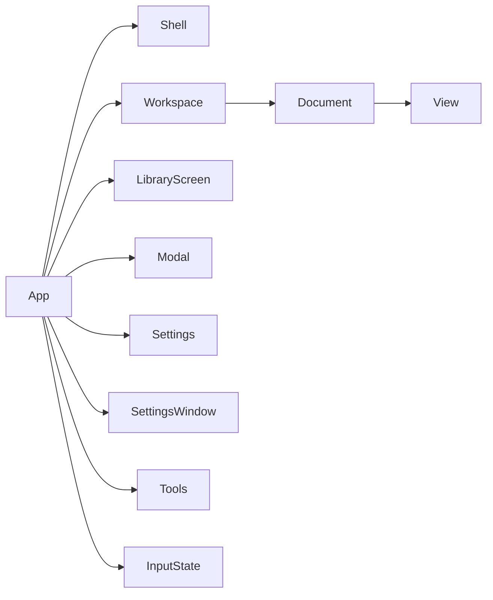

# Architecture

`mothref` owns the event loop and wires together independent crates:

- `moth-scene`: pixel-free image metadata, UUIDv7 identity, fractional ordering,
  reversible commands, an R-tree and an ordered index for top-item lookup.
  Commands return their inverse; the storage
  worker journals undo/redo before acknowledgment.
- `moth-format`: byte-stream storage contracts, opaque handles, schema-one
  records, checkpoint replay and atomic compaction. See [FORMAT.md](FORMAT.md).
- `moth-io`: bounded Rayon decode work, header checks and panic isolation. JPEG
  uses allocation-budgeted DCT scaling, EXIF orientation and CMYK conversion; PNG
  and clipboard previews use alpha-weighted area averages, including Adam7 passes.
  Original dimensions determine geometry; pixels live only in worker results
  and the renderer. Whole-image previews stop at 2048 pixels on the long side;
  large images keep only a 256-pixel fallback and use fixed 256×256 tiles for
  visible detail at every finer level, including original resolution. PNG/GIF/BMP rows
  share the preview streaming path; native JPEG tiles use mozjpeg scanlines.
- `moth-platform`: native path resolution, clipboard access and durable staging.
  Filesystem and clipboard calls run in workers. Registration on the event
  thread records a path without opening it. The storage worker copies imported
  originals into the journal before acknowledging their scene commands.
- `moth-import`: foreign board extraction and conversion into scene data;
  `.pur` behavior, compatibility and limits are specified in
  [PUR-IMPORT.md](PUR-IMPORT.md).
- `moth-render`: instanced quads and a GPU resource registry, shared by the window
  and headless checks. Texture pages use size classes, full mip pyramids and
  page-level LRU eviction. Original bytes do not depend on a GPU texture format.
- `moth-ui`: theme tokens, bundled licensed font, localized string lookup and
  responsive wrapped controls. Pan/select, fit, zoom and paste have visible
  controls for touch input.

The native input adapter is the only app code consuming raw mouse events.
Normalized pointers carry identity, kind and pressure; two-contact pan/pinch is
implemented by a separate gesture layer. On native Linux Wayland, the adapter
supplements winit 0.30 with `tablet-v2` on the same display connection. A worker
batches tool motion, pressure and contact phases at protocol frames; logical
surface coordinates are already scaled. Pen input reaches both canvas selection
and egui controls. Proximity loss/removal cancels contacts. Touch input continues
through winit and the separate gesture layer; real touch-device qualification is
still pending.

## Budgets and lifetimes

| Resource | Bound |
| --- | --- |
| App board admission / waiting import backlog | 1,000,000 items / 1,024 handles |
| Desktop source catalog | 1,000,000 handles |
| Texture arrays, including every layer and mip | Adaptive: 32–512 MiB discrete GPU, 32–96 MiB shared/software; 0 for no images (decision 0009) |
| Instance buffer | 10,000 instances, 880,000 bytes, reused between ordered batch submissions |
| Decode requests / completed images | 8 / 2 |
| Concurrent decode consumers | min(cores − 1, 4), at least 1 |
| Rayon pool threads | cores − 1, at least 1 |
| Compressed source / raw scratch input | 64 MiB |
| Header dimensions / non-JPEG pixel count | 32,768 per side / 32 × 1024² pixels |
| JPEG reduced planes + estimated progressive coefficients | 128 MiB admission budget |
| Area accumulator | At most 2048² × 32 bytes |
| PNG decoder internal allocations | 8 MiB |
| Clipboard requests / results | 1 / 1 |
| Clipboard staging directory, per board | 8 GiB and 10,000 entries |
| Native clipboard file list | 1,024 absolute paths |
| Storage requests / results | 32 / 32 |
| Undo/redo | 256 session commands |

The decode concurrency cap bounds temporary pixels independently of CPU count.
Texture lookup entries exist only for resident slots. Texture pages and lookup
entries are evicted together; debug teardown checks allocation accounting returns
to zero. Decoded pyramids are retained only by the LOD cache.

LOD cache and performance modes: `moth_io::LodCache` is shared by all tab decode pools. Preview requests carry the
item's blob hash; the worker answers from the cache before opening the original.
On a miss, caching modes decode at `max(2 × requested side, 256)` and slice later
requests from that pyramid; slices always satisfy the renderer's residency rule.
"In memory" (default) and "In memory, low zoom quality" (1024 px cap) keep
pyramids in RAM within 12.5% of available RAM (≤ 1 GiB, LRU) and write them through
to the disk cache, so a RAM miss reads the file instead of decoding. "Cache on disk"
writes checksummed pyramids through `moth-platform::lod_store` into the OS cache
folder (8 GiB, LRU pruning on decode workers). "No cache" decodes every level from the
original. Imports keep their 256-pixel decode in every mode. Cache entries are
rebuildable and never stored in `.moth`. See [decision 0014](decisions/0014-performance-modes-lod-cache.md).

The clipboard worker stages original pixels as lossless PNG (RGB for wholly
opaque images, RGBA otherwise) with a bounded 256 KiB output buffer before reporting
success and passes an already-built preview with the result. The preview hash
matches the staged PNG, so eviction reloads the same content. PNG bytes are hashed
while writing and the preview reuses that identity, avoiding redundant pixel
hashing and a file reread. File and directory syncs finish before staging returns.
Recovery files are
private to the user on Unix and never overwrite existing files. Staging rejects
new pastes when its budget is full; it never evicts originals. Native clipboard
file lists enter the same bounded import path as file drops. Unsupported/empty
payloads and saturated queues have localized feedback. When no native file/image
payload exists, explicit Paste can import a direct HTTP(S) image URL or the first
HTML `img[src]`. The worker parses at most 1 MiB of captured text/HTML and validates
URLs up to 8 KiB. Downloads have a shared 20-second HTTP deadline, at most five
redirects and a 64 MiB input limit; existing decoder limits also apply. Every
redirect is validated, embedded credentials and HTTPS downgrades are rejected,
and TLS uses OS trust roots. Original downloaded bytes are synced in the same
budgeted recovery directory, then pass through the existing command/journal path.
No web pages or scripts execute, and clipboard polling never starts downloads.

Explicit discard removes only this board's staged originals and journal; crashes
retain them for the recovery browser. Legacy checksummed `.rgba` scratch records
remain readable, but do not preserve layout by themselves.

The event loop waits between input, worker completions and requested UI animation
frames. Zero-sized windows do not render. Surface loss, suspend/resume and device
loss replace GPU/UI resources while retaining scene metadata, camera and source
handles. Adapter creation retries a fallback adapter; `--software` forces it.
RGBA8 is the portable baseline; BC7 is chosen at runtime on adapters that
support it, with RGBA8 as the fallback.

## Current limits

Browser JPEG tiles await the Web Worker codec in M8; the native mozjpeg dependency
is excluded from WASM builds. WebP retains its existing 8 MiB full-frame admission
limit because the codec cannot expose scanlines. Progressive JPEG coefficient
planes have a separate admission check; rejected tiles leave the preview visible.
Rendering uses fixed-size ordered batches
instead of dropping items beyond the first 10,000. App admission, import backlog,
source catalog, input-byte, journal and snapshot budgets still apply; this does
not promise that every million-item board fits a 64 MiB checkpoint.

winit 0.30 does not deliver native Wayland drops itself. The input adapter binds
`wl_data_device_manager` on winit's existing connection, negotiates copy-only
`text/uri-list` offers for its own surface and receives local paths on a transfer
worker. Transfers allow at most 1 MiB, 1,024 paths and five seconds; remote URLs
and malformed paths fail without importing a partial list. Offers survive
`leave` until a successful read finishes the protocol operation. Both native
workers sleep when idle, queues are bounded (256 events, one waiting transfer),
and seats/tools/tablets/offers are capped at 64 each. The display handle outlives
all guest proxies and workers; suspension retains the adapter rather than
rebinding native devices. Clipboard interoperability and pen/touch behavior still
need qualification on other desktops.
The Wayland decoration backend omits its title font to avoid an unmaintained font
parser; the application title is shown in the toolbar.

## M1 persistence

The storage worker has 32 request and 32 result slots. Scene mutations are
validated, journaled and synced before the UI receives their command. Originals
are copied into private recovery storage before acknowledgment, so external source
changes cannot destroy an acknowledged image. Scene metadata is duplicated in the
worker to validate commands and provide checkpoints without blocking frames.

The journal is the durable original store. Originals use opaque handles to bounded,
read-only ranges in the session journal, with independent cursors for decoding,
export and save; no separate `.source` copies are created. Opening `.moth` copies
live originals in source-offset order, verifying their hashes before journaling.
Foreign import journals unique originals directly during parsing. A new blob and
its insert share one journal sync. Opening/import publishes the first durable item
and then batches after 64 commands or 32 MiB of original data, allowing visible
previews to decode while storage continues. Loading progress does not finish the
request; editing/save remain blocked. Full `.moth` bounds keep its loading camera
stable; foreign stream order is corrected to the source stacking order before
completion, retaining stable ids and one import undo step. Errors preserve durable
partial items and clear the UI destination so saving requires a separate filename.
The final checkpoint commits the complete load. Board compaction never replaces the session
journal, preserving original handles (decision 0011).
Neither path acknowledges anything before that sync; append/sync failures poison
the worker. Clipboard staging still syncs its original before handing it to the
storage worker. No on-disk format or admission budget changes.

Healthy `.moth` reads walk the adjacent footer chain backwards, then verify and
apply records forwards. The temporary offset index is capped at one million
entries (at most 8 MiB allocated); larger, torn, gapped or corrupt streams retain
the scanner path. Payload and footer checksums remain mandatory (decision 0012).

Each explicit save appends missing original blobs and one atomic checkpoint.
Three immutable backups per destination survive session discard. Compaction uses
a sibling temporary object and atomic replacement. Recovery, recent-file discovery
and source extraction run on the worker. The path field, recent/recovery buttons,
Save/Open and undo/redo controls provide pointer paths for all new operations.
Undo/redo retains 256 commands per session; it is not restored from disk.

RGBA8 preview uploads remain the portable baseline; the runtime image format is
chosen from adapter capabilities (BC7 on desktop, RGBA8 fallback, ASTC planned
for M8). Board I/O never runs on the event thread.
See [M0 validation](M0-VALIDATION.md), [M1 validation](M1-VALIDATION.md) and the
[debt backlog](TECH-DEBT.md) for historical measurements, executed checks and
remaining gates. M0's earlier volatile-canvas and raw-staging descriptions are
historical, not the current persistence contract.

GIF previews decode only the first frame, row by row, including interlace passes
and transparent offsets. BMP previews reuse the existing codec's palette/bitfield
conversion on bounded single-row records; supported DIB headers are 12, 40, 52,
56, 108 and 124 bytes. Pixel offsets are capped at 64 KiB. RLE/JPEG/PNG-compressed
BMPs are rejected rather than routed through full-frame decoding. Both feed the
same alpha-weighted area accumulator as PNG/clipboard previews.

WebP uses the maintainer-approved full-frame exception in
[ADR 0003](decisions/0003-bounded-webp-previews.md): static files only, encoded input
and full RGBA frame each at most 8 MiB. Embedded VP8/VP8L dimensions are validated
against the canvas before pixel decoding. Area averaging and EXIF orientation
produce the preview, and the full frame is immediately released. These are hard
input/frame limits, not a cap on every private allocation inside the dependency.

## Reference workspace

The `Workspace` parks up to four independent `Document`s, each with its own
journal, scene, decode requests and `View` (camera and viewport). Switching clears image residency;
inactive completions are drained without GPU uploads. Destination leases prevent
two sessions in this process from writing the same canonical native path.

The application boundary is `App → {Shell, Workspace, LibraryScreen, Modal,
Settings, SettingsWindow, Tools, InputState}`. `App` coordinates the native event loop; these types keep
window/GPU state, board lifetimes, library widgets/textures, dialogs, tool drafts
and pointer state separate.

`Settings` owns persisted preferences. One schema generates preference keys,
validation, settings rows, defaults and command-search results. Its window is
separate from per-board transient editors. `surfaces.rs` defines ordered action
lists for the bottom toolbar, selection bars and context menu; availability and
effects come from `action_enabled` / `run_action`. UI modules build no scene
commands. `Tools` retains only editor/picker drafts, arrangement state and
read-only diagnostic snapshots; the Board tools window is removed. Theme colors
and surface metrics come from active `moth-ui::Tokens` in both light and dark
sets. See [implementation and validation notes](plans/ui-architecture/VALIDATION.md).

The frame path is **event → Gesture/Intent → apply → render**. `InputState`
adapts native pointers and recognizes gestures. `chrome`, `canvas` and
`Modal::show` return intent vectors; text fields, checkboxes and inspector drafts
retain their local widget input. Canvas layout uses a local `View` and emits it
before user actions, so hit testing and drawing share the same camera without
mutating the document inside the UI pass. `SaveAndClose` arms the close and
queues a save; only a successful storage completion permits journal discard.

`Workspace::{activate,new_board,open_in_tab,request_close,finish_close}` return
`TabChange`. `App::reset_board_ui` resets transient editors and restores tab view flags, clears library/editor
and gesture state, and clears texture residency after a switch. `Workspace::pump`
drains all tab workers, applies journal acknowledgments to their owning scenes,
and returns UI events. Active decoded images go straight to `Shell::upload`
through a callback; inactive tabs never upload and no intermediate pixel queue
accumulates. Journal identity stays with the document when tabs switch.

`Document::visible` selects items; `request_images` schedules their missing LODs
only after the frame substitutes drag/animation previews. `Shell::render`
acquires the surface, updates egui textures/buffers, draws the supplied item
references, presents, frees textures and schedules the next repaint. Device and
surface recovery rebuild GPU/egui state while retaining documents; `App` resets
renderer-dependent UI and refreshes visible library previews. `frame()` only
coordinates surface checks, worker results, UI, intent application and rendering.

An independent library worker indexes at most twenty recent and twenty pinned
boards. It produces four 128-pixel previews per entry (at most 10 MiB of egui
textures). Leaving the library drops those handles. Pins and bounded tag metadata
use atomic replacement in app-owned storage. Core crates still see byte streams
and opaque handles, never native paths.

Overlay mode composites the complete board once, then applies opacity. Its
registry-managed intermediate texture has a separate 64 MiB ceiling and is freed
on renderer clear. A separate interactive controller restores the main window's
input and pin state on exit. Native capability flags disable unsupported actions.
See [decision 0004](decisions/0004-reference-workspace.md).

GPU image-cache growth follows actual allocated size-class pages, including mips
and fallback images, rather than image-item count. A platform worker samples
available physical RAM at most every two active seconds; the event loop only
reads bounded messages. By default the ceiling is `(available RAM + current image pages) / 8`,
capped at 96 MiB on shared/software adapters and 512 MiB on discrete GPUs. Settings
allow 1–50% of that RAM base and either automatic adapter caps or a manual
32–512 MiB cap (including on shared adapters). Unknown RAM uses the selected cap.
The default remains 12.5% with automatic limits; invalid saved values fall back
to these defaults. Changes apply immediately, persist through the existing
settings worker, and reset with other preferences. Budget growth allocates nothing until an upload needs a
page; lower ceilings immediately evict LRU pages, including below the normal
32 MiB floor. Empty boards clear the cache. No timer wakes an idle application;
pressure changes are observed on subsequent activity. See decision 0013.

## Viewport request scheduling and tiles

`DecodePool::requests` keeps at most eight queued requests and four active decoder
batches, with up to eight neighboring tiles per batch. Eight completion slots let
a complete tile batch become ready between UI frames.
Imports are not cancelled. Each frame replaces viewport requests with the highest
priorities: visible area first, then distance to the viewport center. Shared blobs
use their largest demand; the camera's final transition target drives requests,
while the current and target views both protect resident tiles. Superseded queued
jobs disappear; active jobs check cancellation before expensive stages and tile
rows check it during decoding. Stale completions never upload. Workers sleep on a
condition variable between requests, without polling.

Large-image pyramid levels are chosen in source pixels per physical screen pixel,
with at most 2× sampling headroom per axis. Original-resolution tiles are requested
only at ≥ 1:1. Large images keep a 256-pixel preview instead of allocating a large
square whole-image texture; finer levels use the fixed-size atlas.
A tile holds 254×254 content pixels and a one-pixel filter gutter in a fixed-size
256×256 array layer. Affine coverage includes frame/content rotation, panning,
cropping and mirroring. Each visible cell draws either its tile or the corresponding
preview region, so transparent images are never drawn twice. Both use the same
ordered instancing path and registry budget. Tiles share 256-pixel pages, are
removed when no longer needed by the current/target viewport, and release empty
pages. Low-quality mode retains its capped whole-image preview path. Small whole-image
previews retain the existing size classes and GPU mip
copy downsizing with zoom headroom.

Tile cache keys derive from the original hash plus pyramid level and coordinates;
original blob identity is unchanged. RAM/disk caching uses the existing budgets,
LRU, checksums and rebuildable cache format. No board schema or journal changes.
See [decision 0015](decisions/0015-viewport-tiles-and-scheduling.md).

Tile packs: in the "In memory" and "Cache on disk" modes, the first viewport request
for an image drawn from tiles offers it to the pool's `lod-bake` thread. One decode of
the original into an oriented RGBA frame, followed by alpha-weighted 2×2 averaging per
level (`tiles::bake`), emits every tile of every tiled level and the 256-pixel preview,
encodes them to the GPU format (opaque or alpha ultra-fast BC7) and writes one
checksummed pack per image and format through `LodStore::writer`. Tile requests read
the pack first, through the OS file cache, before the RAM/disk caches or the original.
While a tile loads, the renderer draws the matching region of the nearest resident
tile up to `PARENT_LEVELS` levels coarser; the viewport keeps those ancestors
resident. The "Prepare zoom tiles" preference (`moth_io::BakeMode`, shared through
the `LodCache`) chooses on-screen images only (default), the whole open board behind
them, or no new packs. See [decision 0016](decisions/0016-baked-tile-packs.md).

Full-resolution mode (`CacheMode::Full`, default): `DecodePool::preload` prepares each
original's 256-pixel preview and all tiles (images above 256 px are tiled in this mode)
on preload workers, from the disk cache and packs when present, otherwise by one
streamed bake that also writes the pack. `App::upload_preloaded` uploads them within a
per-frame time slice and checks `Registry::fits` first; the first misfit cancels the
pass, warns, and clears `Registry::keep_all`, which otherwise keeps every upload
resident. The board is covered by a progress bar and gets no viewport requests until
the initial pass settles. Texture limits come from `moth-platform::gpu` detection on a
worker thread (`Registry::set_hard_limit`); shared-memory adapters also follow free RAM
(`memory::shared_ceiling`). See [decision 0017](decisions/0017-full-resolution-mode.md).

Before scheduling, the registry fits the union of current/target tile coverage to
whole-page capacity after reserving visible preview and fallback pages. It raises
the mip floor under a small VRAM ceiling and restores detail when space returns.
At capacity, uploads reuse the oldest layer in the matching size class rather than
evicting every neighboring image in that page. This keeps a fitting viewport from
cycling its own detail through the decoder.

Neighboring tile requests at the same pyramid level share one input read and one
codec scan, in batches of at most eight. Only one tile batch per source runs at a
time; unrelated images retain parallel decoding. Cancellation aborts a batch once
none of its tiles is wanted; individual stale completions still get discarded.
JPEG levels below 1:1 use reduced IDCT (up to 1/8 per axis); original-resolution
samples copy directly without area sums. Other area bins use u32 sums through
level eight and u64 beyond that to preserve alpha weighting without overflow.
Coarse previews up to 256 px bypass the cache's whole-image decode headroom.
Settings sample disk usage and clear completed `.lod` files through a bounded
maintenance worker. Active temporary files and board data are untouched;
concurrent decode writes can repopulate the cache after a clear.

The same direct-pixel path applies to unscaled PNG/GIF/BMP whole previews,
including interlaced row scattering; alpha-zero pixels retain the previous
normalization. Mip filtering and integrity validation remain unchanged.
